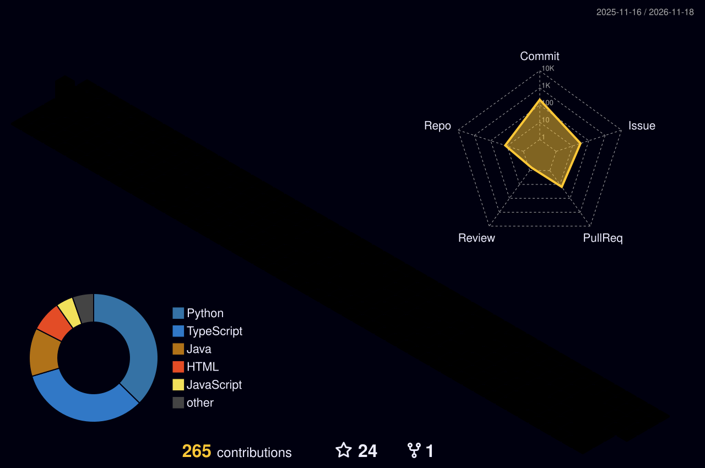

<div align="center">



<br><br>

<a href="https://gabriel-de-sa-mendes.vercel.app/"></a>
<a href="https://www.linkedin.com/in/gabriel-de-s%C3%A1-640314211/"></a>
<a href="mailto:gabrieldesamendes@gmail.com"></a>
<a href="https://www.instagram.com/gabrieldsa_mendes/"></a>

</div>

## Sobre mim

Olá! Me chamo **Gabriel** e sou **desenvolvedor full stack** em Palmas, Tocantins. Sou **idealizador e entusiasta da [Mídia Startup](https://midia-startup.midia63.com.br/)**, a software house por trás do Mídia 63, do MidiaComercial e da Agromidia.

Trabalho com arquitetura de software, APIs REST, integração de sistemas e automação, do banco ao deploy: **Python (Django, DRF, FastAPI)**, **React e TypeScript**, **PostgreSQL** e VPS com Docker e Nginx. Uso IA como parte do fluxo, não como atalho: **a IA propõe, uma pessoa decide**.

```python
class Gabriel:
    base     = "Palmas, Tocantins 🇧🇷"
    cargo    = "Desenvolvedor Full Stack · Estagiário na Prefeitura de Palmas"
    startup  = "Idealizador e entusiasta da Mídia Startup"
    fiz      = ["Mídia 63", "MidiaComercial", "Portal do SEI", "ATOM Agent"]
    agora    = "Impulso63, o próximo produto da Mídia Startup"
    contato  = "gabrieldesamendes@gmail.com"
    lema     = "Do conceito ao deploy."
```

## Ecossistema Mídia Startup

Produtos que saem da software house que idealizei. Prints e demonstrações animadas no [portfólio](https://gabriel-de-sa-mendes.vercel.app/#ecossistema).

| Produto | Status | O que é | Stack |
| --- | --- | --- | --- |
| [**Mídia 63**](https://www.midia63.com.br/) | 🟢 em produção | Portal de notícias do Tocantins: site, painel da redação e API. Uma esteira de agentes leva a matéria do rascunho ao site, ao Instagram e ao YouTube. O **Hermes** reescreve e faz a triagem de capas, mas só o editor publica. | Django 5.2, DRF, React 19, Tailwind 4, PostgreSQL |
| [**MidiaComercial**](https://midia-comercial.midia63.com.br/) | 🟢 no ar · novo | Inteligência comercial para lojistas de shopping. O que o cliente procurou e não tinha é registrado por voz no balcão; saem no máximo 3 decisões com evidência e um agente de vendas que prepara a mensagem. Feito no Hackrun com a Equipe NidoQueen. [Código](https://github.com/GabrielGGC18/MidiaComercial) | Django 5.2, Django Ninja, React 19, Tailwind 4 |
| [**Mídia Startup**](https://midia-startup.midia63.com.br/) | 🟢 no ar | Site da software house (ex-GSM Startup) e painel da equipe com kanban, CRM e DevHub com o ATOM. | Django, DRF, React 19, Docker |
| [**Agromidia**](https://midia-startup.midia63.com.br/catalogo) | 🟢 no ar | Loja do campo: produtos do produtor, retirada ou frete e pagamento via Pix. | Django, React, Pix |
| **Mídia Finanças** | 🔒 interno | Gestão financeira da operação do Mídia 63: receitas, despesas e relatórios. | Python, Django |
| **Impulso63** | 🟡 em desenvolvimento | O próximo produto do ecossistema, começando agora. | Django, React, IA |

## Experiência

| Onde | O que fiz |
| --- | --- |
| **Portal do SEI** | Desenvolvi o Portal do SEI em **Django**: a porta de acesso para o **SEI** (Sistema Eletrônico de Informações). São sistemas diferentes: o SEI é em PHP, e o portal é por onde as pessoas chegam até ele. |
| **SEI** | Manutenção e evolução de telas e formulários no SEI, em **PHP**. |
| **Prefeitura de Palmas–TO** | Estagiário de desenvolvimento: sistemas internos em Django e DRF, como o [Agtec SaaS](https://github.com/GabrielGGC18/agtec_saas). |
| **Mídia Startup** | Idealizador e entusiasta: Mídia 63, MidiaComercial, Agromidia, Mídia Finanças e Impulso63. |
| **Hackrun · Equipe NidoQueen** | MidiaComercial: produto, arquitetura, agente de vendas e pitch de 90 segundos. |

**Formação:** Engenharia de Software (Centro Universitário Católica do Tocantins) · Sistemas de Informação (Universidade Estadual do Tocantins, Unitins)

## IA e automação

| Projeto | Descrição | Stack |
| --- | --- | --- |
| [**ATOM Agent**](https://github.com/GabrielGGC18/Atom-) | Orquestrador de agentes sobre o Claude Code (v1.2): uma skill por stack, um subagente por domínio, hook de guarda e memória compartilhada entre Claude, Codex, OpenCode e Copilot. | Claude Code, Skills, Subagentes, Hooks |
| [**ATOM Canvas**](https://github.com/GabrielGGC18/Atom-canvas) | Canvas infinito para orquestrar agentes de IA lado a lado, com terminais reais, notas e workspaces salvos. Open source. | Python, aiohttp, xterm.js |
| **Fábrica de Cortes** | Dentro do Mídia 63: uma live vira até 20 cortes 9:16 com arte e legenda, ou um vídeo 16:9 para o YouTube, publicados só depois da aprovação. | Django, FFmpeg, YouTube API, Instagram API |
| **Midia-Editor** | Estúdio local de vídeo com IA: transcrição palavra a palavra, verticais enquadrados no rosto e acabamento com a marca. | React, TypeScript, Node, FFmpeg, faster-whisper |

## Mais projetos

| Projeto | Descrição | Stack |
| --- | --- | --- |
| [**Agtec SaaS**](https://github.com/GabrielGGC18/agtec_saas) | SaaS modular para a Prefeitura de Palmas, com API REST. | Django 5.2, DRF, Docker |
| **Portal P1 News** | Portal de notícias para cliente. | Django 5.2, PostgreSQL |
| [**Loja de Violas · API**](https://github.com/GabrielGGC18/e-commerce-loja-viola) | API REST de e-commerce com Hibernate Panache e Swagger. | Java, Quarkus, PostgreSQL |
| [**Fundo de Vila**](https://github.com/GabrielGGC18/Fundo-vila) | Põe sua foto numa vila estilo Minecraft, com remoção de fundo e efeito pixel. | HTML, Canvas, JS |
| [**FastAPI**](https://github.com/GabrielGGC18/FastAPI) | APIs REST assíncronas com Pydantic e versionamento. | Python, FastAPI |
| [**Force Up Fit**](https://gabrielggc18.github.io/Force-up-Fit-new/) | Site de treinos e condicionamento físico. | HTML, CSS, JS |
| [**Portfólio**](https://gabriel-de-sa-mendes.vercel.app/) | Este repositório: meu site autoral, vitrine dos meus projetos. | HTML, CSS, JavaScript |

## Stack

<div align="center">

<table>
  <tr>
    <td align="right"><sub><b>BACK-END</b></sub></td>
    <td>
      
      
      
      
      
      
      
      
      
    </td>
  </tr>
  <tr>
    <td align="right"><sub><b>FRONT-END</b></sub></td>
    <td>
      
      
      
      
      
      
      
    </td>
  </tr>
  <tr>
    <td align="right"><sub><b>DADOS</b></sub></td>
    <td>
      
      
      
    </td>
  </tr>
  <tr>
    <td align="right"><sub><b>DEVOPS</b></sub></td>
    <td>
      
      
      
      
      
    </td>
  </tr>
  <tr>
    <td align="right"><sub><b>IA E QUALIDADE</b></sub></td>
    <td>
      
      
      
      
      
    </td>
  </tr>
</table>

</div>

## Números

<div align="center">


</div>

## Contribuições em 3D

<div align="center">

<!-- Gerado diariamente por .github/workflows/profile-3d.yml -->


<!-- Gerado a cada 12h por .github/workflows/snake.yml -->
<picture>
  <source media="(prefers-color-scheme: dark)" srcset="assets/readme/snake-dark.svg">
  
</picture>

</div>
